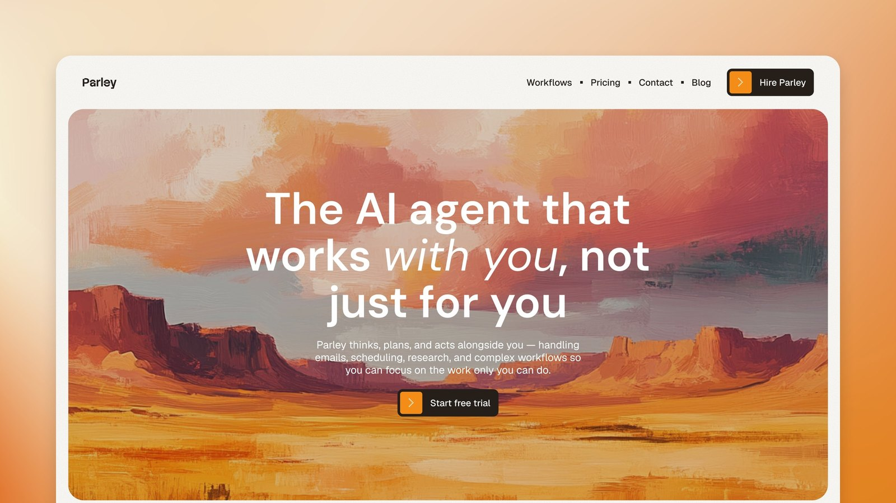

<p align="center">
  <a href="https://startfrom.co/?utm_source=github&utm_medium=readme&utm_campaign=parley"></a>
</p>

<p align="center">
  <a href="./LICENSE"></a>
  
  
  
</p>

<p align="center">
  <a href="https://parley.startfrom.co"><b>Astro demo</b></a>
  &nbsp;·&nbsp;
  <a href="https://parley-next.startfrom.co"><b>Next.js demo</b></a>
  &nbsp;·&nbsp;
  <a href="https://startfrom.co/?utm_source=github&utm_medium=readme&utm_campaign=parley"><b>Startfrom</b></a>
  &nbsp;·&nbsp;
  <a href="https://buy.polar.sh/polar_cl_C7mCmNfCQK9xTynrq5u0t4I4CpMoRc5tN5UCB3mx56l?utm_source=github&utm_medium=readme&utm_campaign=parley"><b>All Astro Themes</b></a>
</p>

# Parley: Astro and Next.js

A modern AI agent template built on one idea: AI that works with you, not
just for you.

Parley is for AI startups, SaaS founders, and teams that want a site that
reads like a real product rather than a side project. A warm, editorial
aesthetic that stands apart from the sea of dark, neon AI sites, with the
structure to turn visitors into trials.

Free, MIT licensed.

[](https://vercel.com/new/clone?repository-url=https%3A%2F%2Fgithub.com%2Fagnilem%2Fparley-astro&project-name=parley&repository-name=parley&demo-title=Parley&demo-description=A%20warm%2C%20editorial%20AI%20agent%20and%20SaaS%20template%20built%20with%20Astro.&demo-url=https%3A%2F%2Fparley.startfrom.co&demo-image=https%3A%2F%2Fparley.startfrom.co%2Fassets%2Fog-image.jpg)

```sh
npm install
npm run dev        # localhost:4321
npm run build      # static output in dist/
```

Astro 7, `output: 'static'`, no CSS framework, no UI framework.

<!-- repo-only -->
## Next.js version

The same site in Next.js 16 (App Router, React 19, static export) lives in
`next/`, with its own README. It is generated from this Astro source by
`tools/astro-to-next.mjs` (styles: `tools/collect-css.mjs`), and
`tools/variantcmp.mjs` checks the two builds element by element at desktop,
tablet and phone widths.

```sh
cd next
npm install
npm run dev        # localhost:3000
npm run build      # static output in out/
```

To deploy it on Vercel, import the repo and set the Root Directory to `next`.
Its environment variables are the Astro ones with a `NEXT_PUBLIC_` prefix.
Changed the Astro source? Regenerate from the repo root (after `npm install`):

```sh
node tools/astro-to-next.mjs && node tools/collect-css.mjs
```
<!-- /repo-only -->

The artwork and logos ship with it under the same licence, though most people
will swap them for their own.

Parley is a template and demonstration brand. Connect your own forms,
analytics and services before launch.

## Deploy

Click **Deploy with Vercel** above. It clones the repo to your GitHub account
and deploys it with the Astro preset: no environment variables required.

The two optional variables, `PUBLIC_FORM_ENDPOINT` and
`PUBLIC_VERCEL_ANALYTICS`, can be added later in the project settings.

## Routes (22)

| Route | What it is |
| --- | --- |
| `/` | hero, logo strip, benefit cards, delegation tabs, testimonials, pricing, how-it-works, FAQ, integrations |
| `/workflows` | workflow index, build-your-own, before/after comparison |
| `/workflow-1` … `/workflow-3` | generated from the `workflows` group |
| `/pricing` | plan cards, billing toggle, full feature comparison table |
| `/contact` | contact methods and form |
| `/blog` | featured post, side list, card grid |
| `/blog/[slug]` | ten articles, generated from Markdown |
| `/terms-conditions` | six numbered sections |
| `/waitlist`, `/thank-you` | chromeless `Bare` layout |
| `/404` | no closing CTA |

## Structure

- `src/layouts/` — `Base.astro` (nav, closing CTA, footer, analytics gate),
  `Bare.astro` (waitlist and thank-you), `Head.astro` (meta)
- `src/components/sections/` — one component per section of the design
- `src/components/Button.astro` — port of the Framer `Buttons/button` component
- `src/content/blog/` — one Markdown file per article
- `src/content/content.json` — everything repeated: logos, benefits, features,
  testimonials, plans, FAQs, integration tiles, nav and footer links, workflow
  pages, the comparison matrix, contact methods, terms sections
- `src/styles/tokens.css` — colours, easings, the type scale, layout tokens
- `src/styles/global.css` — home page and shared chrome
- `src/styles/pages.css` — inner pages and the breakpoint overrides
- `src/scripts/` — twelve behaviour modules, one per section, wired in
  `entry.js`; each receives the `prefers-reduced-motion` flag

## Blog and CMS

Articles are Markdown with typed frontmatter, loaded through Astro's `glob()`
collection (`src/content.config.ts`). The index cards, the category-matched
related strip and the sitemap all read from the same files, so editing a post
updates every surface. The loader keeps filenames verbatim as ids, so a slug
like `parley-2.0-meet-the-new-agent-builder` survives with its dot intact.

An optional admin UI ships at `/admin/` using
[Sveltia CMS](https://sveltiacms.app): a single static page, no build
integration, no dependencies. Locally, run `npm run dev`, open `/admin/` and
choose "Work with Local Repository". For production editing, set your repo in
`public/admin/config.yml` and register a GitHub OAuth app. Don't want it?
Delete `public/admin/`.

## Forms

The contact and waitlist forms post their fields as JSON to
`PUBLIC_FORM_ENDPOINT`. Leave it unset and submissions stay in the browser:
the form shows its success state and nothing is sent.

```sh
PUBLIC_FORM_ENDPOINT=https://your-handler.example.com npm run build
```

## Analytics

`@vercel/analytics` and `@vercel/speed-insights` mount only when
`PUBLIC_VERCEL_ANALYTICS` is set, so a build without it ships zero `_vercel`
references.

```sh
npm run build                              # no beacons
PUBLIC_VERCEL_ANALYTICS=1 npm run build    # beacons
```

## Design system

Twelve colour tokens and a sixteen-step type scale as custom properties in
`tokens.css`. Breakpoints are the original's own, 1200 and 810. The type ramp
is stepped rather than fluid: H1 is 68 / 54 / 44 at weight 600.

The five spring transitions from the Framer project are integrated
numerically and emitted as CSS `linear()` easings with their real settling
times, rather than bezier approximations. The default is
`spring-duration 0.4s bounce 0.2`, the button is `spring-physics 500 60 1`,
the mobile menu `spring-physics 600 40 1`.

Every effect degrades: with `prefers-reduced-motion: reduce`, motion is
withdrawn and the layout stays intact.

## Verify

```sh
npm run build && npx astro preview
```

No console errors; no horizontal scrollbar at 1440 / 820 / 390; the hero
expands over ~500px of scroll; the delegation tabs swap on click; marquees
loop; the FAQ opens one item at a time. With reduced motion set, nothing
animates and the layout survives.
